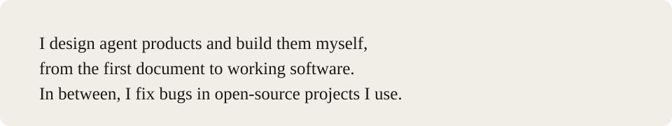

<picture><source media="(prefers-color-scheme: dark)" srcset="assets/header-dark.svg"></picture>

<picture><source media="(prefers-color-scheme: dark)" srcset="assets/intro-dark.svg"></picture>

<picture><source media="(prefers-color-scheme: dark)" srcset="assets/label-upstream-dark.svg"></picture>

<a href="https://github.com/mruby/mruby/pulls?q=is%3Apr+is%3Amerged+author%3Ayuyongyan29-dev"><picture><source media="(prefers-color-scheme: dark)" srcset="assets/up-mruby-dark.svg"></picture></a> <a href="https://github.com/Effect-TS/effect/pulls?q=is%3Apr+is%3Amerged+author%3Ayuyongyan29-dev"><picture><source media="(prefers-color-scheme: dark)" srcset="assets/up-effect-dark.svg"></picture></a> <a href="https://github.com/heyform/heyform/pulls?q=is%3Apr+is%3Amerged+author%3Ayuyongyan29-dev"><picture><source media="(prefers-color-scheme: dark)" srcset="assets/up-heyform-dark.svg"></picture></a>

<picture><source media="(prefers-color-scheme: dark)" srcset="assets/label-made-dark.svg"></picture>

<a href="https://github.com/yuyongyan29-dev/claude-pet"><picture><source media="(prefers-color-scheme: dark)" srcset="assets/made-claude-pet-dark.svg"></picture></a> <a href="https://github.com/yuyongyan29-dev/agent-town"><picture><source media="(prefers-color-scheme: dark)" srcset="assets/made-agent-town-dark.svg"></picture></a> <a href="https://github.com/yuyongyan29-dev/Bree"><picture><source media="(prefers-color-scheme: dark)" srcset="assets/made-bree-dark.svg"></picture></a> <a href="https://github.com/yuyongyan29-dev/jd-radar"><picture><source media="(prefers-color-scheme: dark)" srcset="assets/made-jd-radar-dark.svg"></picture></a> <a href="https://github.com/yuyongyan29-dev/ai-agent-roadmap"><picture><source media="(prefers-color-scheme: dark)" srcset="assets/made-ai-agent-roadmap-dark.svg"></picture></a>

<picture><source media="(prefers-color-scheme: dark)" srcset="assets/label-now-dark.svg"></picture>

<picture><source media="(prefers-color-scheme: dark)" srcset="assets/now-dark.svg"></picture>

 

<a href="mailto:yuyongyan29@gmail.com">yuyongyan29@gmail.com</a>&ensp;·&ensp;<a href="https://x.com/wei_yan77180">@wei_yan77180</a>&ensp;·&ensp;Open to AI PM and agent roles

