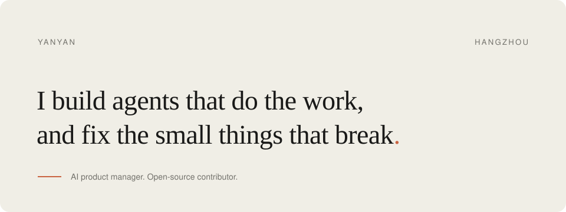

<picture>
  <source media="(prefers-color-scheme: dark)" srcset="assets/hero-dark.svg">
  
</picture>

 
 

I design agent products and build them myself, from the first document to working software. In between, I fix bugs in open-source projects I use. Each fix starts with a reproduction and ends with a test.

 

### Upstream

**[mruby](https://github.com/mruby/mruby/pulls?q=is%3Apr+is%3Amerged+author%3Ayuyongyan29-dev)**&ensp;Long float strings and unpadded base64 now parse correctly.&ensp;2 merged  
**[Effect](https://github.com/Effect-TS/effect/pulls?q=is%3Apr+is%3Amerged+author%3Ayuyongyan29-dev)**&ensp;String case helpers keep Unicode letters and marks.&ensp;1 merged  
**[HeyForm](https://github.com/heyform/heyform/pulls?q=is%3Apr+is%3Amerged+author%3Ayuyongyan29-dev)**&ensp;Dates, report statistics, and dark-mode selects behave as expected.&ensp;5 merged

 

### Made

**[claude-pet](https://github.com/yuyongyan29-dev/claude-pet)**&ensp;A pixel pet that lives above your Claude Code prompt.  
**[agent-town](https://github.com/yuyongyan29-dev/agent-town)**&ensp;Your local coding agents, as a small 3D town.  
**[Bree](https://github.com/yuyongyan29-dev/Bree)**&ensp;A quiet macOS memory inspector for the terminal.  
**[jd-radar](https://github.com/yuyongyan29-dev/jd-radar)**&ensp;A local agent that reads job descriptions so you don't have to guess.  
**[ai-agent-roadmap](https://github.com/yuyongyan29-dev/ai-agent-roadmap)**&ensp;Thirty-seven weeks from zero to production agents.

 

### Now

Building AI assistants and internal tools at cenbo. That work is private.

 

[yuyongyan29@gmail.com](mailto:yuyongyan29@gmail.com)&ensp;·&ensp;[@wei_yan77180](https://x.com/wei_yan77180)&ensp;·&ensp;Open to AI PM and agent roles
