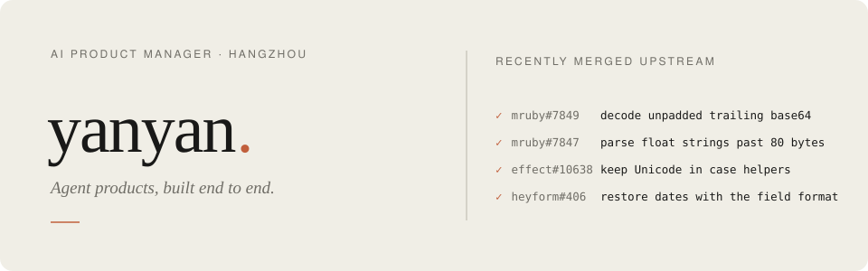

<picture>
  <source media="(prefers-color-scheme: dark)" srcset="assets/header-dark.svg">
  
</picture>

 

I design agent products and build them end to end, from the PRD to working software, with Claude Code and Codex. On the side I fix real bugs in open-source projects, each one starting from a reproduction and ending with a regression test.

## Merged upstream

| | Project | What I fixed | PRs |
| :-: | --- | --- | :-: |
|  | **[mruby](https://github.com/mruby/mruby)** | Long float strings in `String#to_f` and `Float()`; base64 `unpack("m")` without `=` padding | [2 merged](https://github.com/mruby/mruby/pulls?q=is%3Apr+is%3Amerged+author%3Ayuyongyan29-dev) |
|  | **[Effect](https://github.com/Effect-TS/effect)** | Unicode letters, combining marks, and digits in string case helpers | [1 merged](https://github.com/Effect-TS/effect/pulls?q=is%3Apr+is%3Amerged+author%3Ayuyongyan29-dev) |
|  | **[HeyForm](https://github.com/heyform/heyform)** | Date formats in form logic and saved answers, report stats with skipped answers, dark-mode selects | [5 merged](https://github.com/heyform/heyform/pulls?q=is%3Apr+is%3Amerged+author%3Ayuyongyan29-dev) |

[Every pull request I've opened →](https://github.com/pulls?q=is%3Apr+author%3Ayuyongyan29-dev)

## Things I've built

<table>
<tr>
<td width="50%" valign="top">

**[claude-pet](https://github.com/yuyongyan29-dev/claude-pet)**  
Clawd, a pixel pet that lives above your Claude Code prompt.

TypeScript · Claude Code plugin

</td>
<td width="50%" valign="top">

**[agent-town](https://github.com/yuyongyan29-dev/agent-town)**  
Watch your local coding agents at work as a living 3D miniature town.

JavaScript · 3D visualization

</td>
</tr>
<tr>
<td width="50%" valign="top">

**[Bree](https://github.com/yuyongyan29-dev/Bree)**  
A keyboard-driven macOS memory inspector that labels AI and developer tools.

Rust · TUI · macOS

</td>
<td width="50%" valign="top">

**[jd-radar](https://github.com/yuyongyan29-dev/jd-radar)**  
A local agent that turns Chinese job descriptions into decision cards, with red flags and follow-up questions.

Python · Claude Code / Codex agent

</td>
</tr>
</table>

Also: **[ai-agent-roadmap](https://github.com/yuyongyan29-dev/ai-agent-roadmap)**, a 37-week path from zero to production AI agent engineering, with runnable code at every step.

## Right now

At cenbo, building AI assistants for enterprise operations, growth tools for retail campaigns, and mobile workflows for store teams. That work is private.

## Say hi

[yuyongyan29@gmail.com](mailto:yuyongyan29@gmail.com) · [X @wei_yan77180](https://x.com/wei_yan77180) · open to AI PM and agent roles
